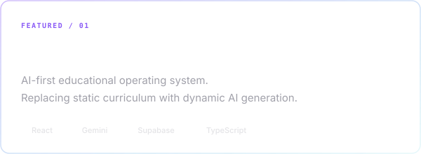
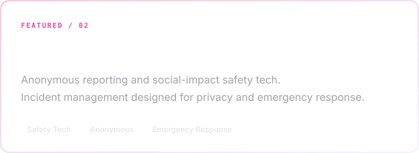
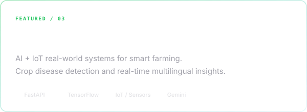
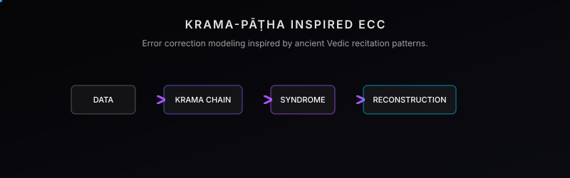

  

 

  

  

  

  

## ✦ FEATURED WORK

 

 

  

## ✦ INTELLIGENCE LAB
_Experiments where data becomes decisions._

 

<table width="100%">
  <tr>
    <td width="50%" align="center">
      <h3>Dry Bean Classification</h3>
      <h2>92.36% TEST ACCURACY</h2>
      
<code>SVM BEST MODEL</code>

      <a href="https://github.com/Aryasurya12/Dry-Bean-Classification-ML">View Project →</a>
    </td>
    <td width="50%" align="center">
      <h3>PM2.5 Prediction</h3>
      <h2>R² 0.85</h2>
      
<code>RANDOM FOREST BEST MODEL</code>

      <a href="https://github.com/Aryasurya12/PM2.5-Air-Quality-Prediction">View Project →</a>
    </td>
  </tr>
</table>

  

## ✦ RESEARCH EXPLORATION

  

  

  
<b>✦ EXPERIMENTAL LAB</b> Projects built to explore an idea, a technology, or simply curiosity.

   
  <ul>
    <li><a href="https://github.com/Aryasurya12/reality-engine"><b>Reality Engine</b></a> — Interactive cinematic web experience pushing WebGL limits.</li>
    <li><a href="https://github.com/Aryasurya12/ctrl-alt-reality"><b>CTRL+ALT+REALITY</b></a> — Immersive 3D physics-based web interface interactions.</li>
    <li><a href="https://github.com/Aryasurya12/Cooketh_flow"><b>Cooketh Flow</b></a> — Visual flowchart and scalable whiteboard canvas.</li>
    <li><a href="https://github.com/Aryasurya12/SpaceScope"><b>SpaceScope</b></a> — Futuristic NASA/ESA space exploration dashboard.</li>
  </ul>

  

## ✦ TECH STACK

   
  <a href="https://skillicons.dev">
      
      
    
  </a>
   

  

## ✦ COMMUNITY & OPEN SOURCE

Learning by building. Contributing to GDG On Campus and collaborating on open-source ecosystems.

> I enjoy turning weird ideas into real prototypes.  
> Making interfaces feel alive.  
> Shipping experiments before they become boring.

   

  
    
  <a href="https://github.com/Aryasurya12">GitHub</a> &nbsp;&nbsp;·&nbsp;&nbsp;
  <a href="https://www.linkedin.com/in/aryasurya12">LinkedIn</a>

