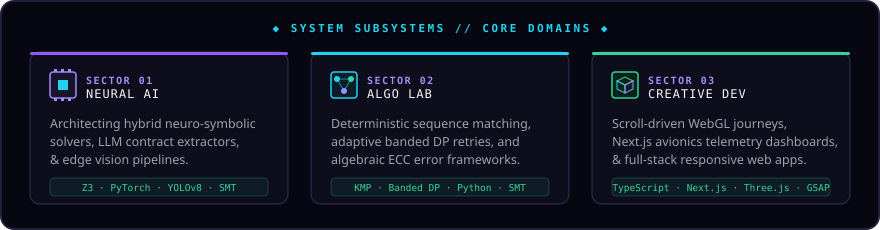

  

 

  

 

  

  

<h3 align="center">✦ FEATURED WORK</h3>

 

  

 

  
  

  

<h3 align="center">✦ INTELLIGENCE LAB</h3>

<em>Experiments where data becomes decisions.</em>

 

<table width="100%" style="background-color: #0B0B12; border: 1px solid rgba(255,255,255,0.08); border-radius: 12px;">
  <tr>
    <td width="50%" align="center" style="padding: 30px; border-right: 1px solid rgba(255,255,255,0.05);">
      <h4 style="color: #8B5CF6; letter-spacing: 1px; font-family: monospace;">DRY BEAN CLASSIFICATION</h4>
      <h2 style="color: #ffffff; font-family: 'Space Grotesk', sans-serif; font-size: 32px; margin: 10px 0;">92.36%</h2>
      
TEST ACCURACY

       
      
SVM BEST MODEL

        
      <a href="https://github.com/Aryasurya12/Dry-Bean-Classification-ML" style="color: #06B6D4; text-decoration: none; font-weight: bold;">View Project &rarr;</a>
    </td>
    <td width="50%" align="center" style="padding: 30px;">
      <h4 style="color: #06B6D4; letter-spacing: 1px; font-family: monospace;">PM2.5 PREDICTION</h4>
      <h2 style="color: #ffffff; font-family: 'Space Grotesk', sans-serif; font-size: 32px; margin: 10px 0;">R² 0.85</h2>
      
MODEL VARIANCE EXPLAINED

       
      
RANDOM FOREST BEST MODEL

        
      <a href="https://github.com/Aryasurya12/PM2.5-Air-Quality-Prediction" style="color: #8B5CF6; text-decoration: none; font-weight: bold;">View Project &rarr;</a>
    </td>
  </tr>
</table>

  

<h3 align="center">✦ RESEARCH EXPLORATION</h3>

  

  

  

    ✦ EXPERIMENTAL LAB
     
    Projects built because I wanted to see what was possible.
  

   
  
  <table width="100%" style="background-color: transparent; border: none;">
    <tr>
      <td width="50%" valign="top" style="border: none; padding: 10px;">
        <h4 style="margin-bottom: 5px;"><a href="https://github.com/Aryasurya12/reality-engine" style="color: #A855F7; text-decoration: none;">Reality Engine</a></h4>
        
Interactive cinematic web experience pushing WebGL limits.

      </td>
      <td width="50%" valign="top" style="border: none; padding: 10px;">
        <h4 style="margin-bottom: 5px;"><a href="https://github.com/Aryasurya12/ctrl-alt-reality" style="color: #06B6D4; text-decoration: none;">CTRL+ALT+REALITY</a></h4>
        
Immersive 3D physics-based web interface interactions.

      </td>
    </tr>
    <tr>
      <td width="50%" valign="top" style="border: none; padding: 10px;">
        <h4 style="margin-bottom: 5px;"><a href="https://github.com/Aryasurya12/Cooketh_flow" style="color: #8B5CF6; text-decoration: none;">Cooketh Flow</a></h4>
        
Visual flowchart and scalable whiteboard canvas.

      </td>
      <td width="50%" valign="top" style="border: none; padding: 10px;">
        <h4 style="margin-bottom: 5px;"><a href="https://github.com/Aryasurya12/SpaceScope" style="color: #10B981; text-decoration: none;">SpaceScope</a></h4>
        
Futuristic NASA/ESA space exploration dashboard.

      </td>
    </tr>
  </table>

  

<h3 align="center">✦ TECH STACK</h3>

   
  <a href="https://skillicons.dev">
      
      
    
  </a>
   

  

<h3 align="center">✦ BEYOND THE CODE</h3>

  

    Learning by building. Active in GDG On Campus and collaborating on open-source ecosystems.  
    <strong style="color: #ffffff;">I like turning &quot;what if?&quot; into something that actually runs.</strong> 
    Making interfaces feel alive and shipping experiments before they become boring.
  

   

  <h2 style="font-family: 'Space Grotesk', sans-serif; letter-spacing: 2px; color: #8B5CF6;">THE NEXT IDEA IS ALREADY LOADING.</h2>
    
  

    <a href="https://github.com/Aryasurya12" style="color: #06B6D4; text-decoration: none;">GitHub</a> &nbsp;&nbsp;|&nbsp;&nbsp;
    <a href="https://www.linkedin.com/in/arya-suryavanshi-9772a9329" style="color: #6366F1; text-decoration: none;">LinkedIn</a> &nbsp;&nbsp;|&nbsp;&nbsp;
    <a href="mailto:aryasuryavanshi1231@gmail.com" style="color: #A855F7; text-decoration: none;">Email</a>
  

