  

 

  

 

  

  

---

### 👾 FEATURED PROJECT UNIVERSE

  <em>Curated showcase of intelligent systems, autonomous edge avionics, algorithmic pipelines, and creative engineering.</em>

 

<!-- Project 1: Neuro-Symbolic Orchestrator (Full Width) -->

  

 

<!-- Project 2: AstroFlow AI (Full Width) -->

  

 

<!-- Project 3: AlignX (Full Width) -->

  

 

<!-- Project 4: ZYNC (Full Width) -->

  

 

<!-- Projects 5 & 6: Reality Engine & SpaceScope (2-Column Grid) -->

  
  

 

<!-- Projects 7 & 8: SheSpeaks & Krushit (2-Column Grid) -->

  
  

  

---

### 🔬 RESEARCH & EXPERIMENTS

  <em>Exploratory investigations in information theory, error resilience, and applied machine learning.</em>

 

<!-- Research Card: Krama-Patha ECC -->

  

 

<!-- ML Benchmarks Table -->
<table width="100%" style="background-color: #0D0D1B; border: 1px solid rgba(167,139,250,0.2); border-radius: 12px; border-collapse: separate; border-spacing: 0;">
  <tr>
    <td width="50%" align="center" style="padding: 26px; border-right: 1px solid rgba(255,255,255,0.06);">
      
&#9670; APPLIED ML BENCHMARK

      <h3 style="color: #ffffff; font-family: 'Space Grotesk', sans-serif; font-size: 18px; margin: 0 0 10px 0;">Dry Bean Multiclass Classification</h3>
      <h2 style="color: #22D3EE; font-family: monospace; font-size: 34px; margin: 0 0 6px 0;">92.36%</h2>
      
TEST ACCURACY (SVM MODEL)

      <a href="https://github.com/Aryasurya12/Dry-Bean-Classification-ML" style="color: #34D399; text-decoration: none; font-family: monospace; font-size: 12px; font-weight: bold;">Inspect Dataset &amp; Notebook &rarr;</a>
    </td>
    <td width="50%" align="center" style="padding: 26px;">
      
&#9670; REGRESSION ANALYSIS

      <h3 style="color: #ffffff; font-family: 'Space Grotesk', sans-serif; font-size: 18px; margin: 0 0 10px 0;">PM2.5 Air Pollution Prediction</h3>
      <h2 style="color: #A78BFA; font-family: monospace; font-size: 34px; margin: 0 0 6px 0;">R² 0.85</h2>
      
VARIANCE EXPLAINED (RANDOM FOREST)

      <a href="https://github.com/Aryasurya12/PM2.5-Air-Quality-Prediction" style="color: #34D399; text-decoration: none; font-family: monospace; font-size: 12px; font-weight: bold;">Inspect Models &amp; Analysis &rarr;</a>
    </td>
  </tr>
</table>

 

<!-- Experimental Sandbox Dropdown -->

  

    &#9654; SYSTEM SANDBOX: Additional Experimental Prototypes
  

   
  <table width="100%" style="background-color: transparent; border: none;">
    <tr>
      <td width="33%" valign="top" style="border: 1px solid rgba(255,255,255,0.06); border-radius: 8px; padding: 16px; background: #0D0D1B;">
        <h4 style="margin: 0 0 6px 0;"><a href="https://github.com/Aryasurya12/ctrl-alt-reality" style="color: #22D3EE; text-decoration: none;">CTRL+ALT+REALITY</a></h4>
        
Immersive 3D physics-based web interface interactions built with Three.js.

      </td>
      <td width="33%" valign="top" style="border: 1px solid rgba(255,255,255,0.06); border-radius: 8px; padding: 16px; background: #0D0D1B;">
        <h4 style="margin: 0 0 6px 0;"><a href="https://github.com/Aryasurya12/Cooketh_flow" style="color: #A78BFA; text-decoration: none;">Cooketh Flow</a></h4>
        
Interactive visual flowchart and scalable whiteboard canvas built with Next.js.

      </td>
      <td width="33%" valign="top" style="border: 1px solid rgba(255,255,255,0.06); border-radius: 8px; padding: 16px; background: #0D0D1B;">
        <h4 style="margin: 0 0 6px 0;"><a href="https://github.com/Aryasurya12/CodeQuest" style="color: #34D399; text-decoration: none;">CodeQuest</a></h4>
        
Gamified Python learning experience with in-browser code evaluation and AI tutor.

      </td>
    </tr>
  </table>

  

---

### 🌐 OPEN-SOURCE & EXTERNAL CONTRIBUTIONS

  <em>Verified contributions to external repositories and collaborative open-source toolkits.</em>

 

<table width="100%" style="background-color: #0D0D1B; border: 1px solid rgba(167,139,250,0.2); border-radius: 12px; border-collapse: separate; border-spacing: 0;">
  <tr>
    <td style="padding: 22px;">
      

        &#10004; MERGED PULL REQUEST
        AUG 2026
      

      <h4 style="margin: 10px 0 6px 0; font-family: 'Space Grotesk', sans-serif;">
        <a href="https://github.com/neilkdbn/RF_Signals_Classifier/pull/4" style="color: #22D3EE; text-decoration: none; font-size: 16px;">
          neilkdbn / RF_Signals_Classifier &mdash; PR #4
        </a>
      </h4>
      

        <strong>Feature: 1D RF Signal Classifiers &mdash; 1D-CNN &amp; CNN-Transformer Architectures</strong>
      

      

        Authored the <code>subsystem2_1d</code> module (+2,787 lines): implemented 1D convolutional neural network and hybrid CNN-Transformer architectures for radio frequency modulation classification across variable SNR levels (-20dB to +18dB), along with complete data loaders, normalization routines, unit test suites, and SNR evaluation benchmarks.
      

      

        PyTorch
        &nbsp;
        1D-CNN
        &nbsp;
        Transformer
        &nbsp;
        Signal Processing
      

    </td>
  </tr>
</table>

  

---

### 🛠️ TECHNICAL CAPABILITIES

  <em>Technologies and toolchains actively exercised across verified codebases.</em>

 

<table width="100%" style="background-color: #0D0D1B; border: 1px solid rgba(167,139,250,0.2); border-radius: 12px; border-collapse: separate; border-spacing: 0;">
  <tr>
    <td width="25%" valign="top" style="padding: 16px; border-right: 1px solid rgba(255,255,255,0.06); border-bottom: 1px solid rgba(255,255,255,0.06);">
      
LANGUAGES

      

        Python &bull; TypeScript &bull; JavaScript &bull; C &bull; C++ &bull; Java
      

    </td>
    <td width="25%" valign="top" style="padding: 16px; border-right: 1px solid rgba(255,255,255,0.06); border-bottom: 1px solid rgba(255,255,255,0.06);">
      
AI &amp; MACHINE LEARNING

      

        PyTorch &bull; MediaPipe &bull; YOLOv8 &bull; Scikit-Learn &bull; BiLSTM &bull; Transformers
      

    </td>
    <td width="25%" valign="top" style="padding: 16px; border-right: 1px solid rgba(255,255,255,0.06); border-bottom: 1px solid rgba(255,255,255,0.06);">
      
FORMAL &amp; ALGORITHMS

      

        Z3 SMT Solver &bull; Banded DP &bull; KMP &bull; GA / PSO &bull; Pydantic
      

    </td>
    <td width="25%" valign="top" style="padding: 16px; border-bottom: 1px solid rgba(255,255,255,0.06);">
      
FRONTEND &amp; CREATIVE

      

        Next.js &bull; React &bull; Three.js &bull; GSAP &bull; Tailwind CSS &bull; Lenis
      

    </td>
  </tr>
  <tr>
    <td width="25%" valign="top" style="padding: 16px; border-right: 1px solid rgba(255,255,255,0.06);">
      
BACKEND &amp; APIS

      

        FastAPI &bull; Node.js &bull; WebSockets &bull; REST APIs
      

    </td>
    <td width="25%" valign="top" style="padding: 16px; border-right: 1px solid rgba(255,255,255,0.06);">
      
DATABASE &amp; CLOUD

      

        Supabase &bull; PostgreSQL &bull; SQLite &bull; Docker
      

    </td>
    <td width="25%" valign="top" style="padding: 16px; border-right: 1px solid rgba(255,255,255,0.06);">
      
TESTING &amp; RUNTIMES

      

        Pytest &bull; Bun &bull; Vite &bull; Git &bull; Linux
      

    </td>
    <td width="25%" valign="top" style="padding: 16px;">
      
HARDWARE &amp; SIGNALS

      

        RF Signals &bull; DSP &bull; IoT Telemetry &bull; OpenCV
      

    </td>
  </tr>
</table>

  

---

### 📊 ACTIVITY TELEMETRY & METRICS

  
  &nbsp;
  

 

  

  

---

### 📡 SYSTEM TRANSMISSION // CONNECT

  

    <em>Thanks for exploring my corner of the digital universe. Open to engineering collaborations, neuro-symbolic research discussions, and creative technology ventures.</em>
  

  

    <a href="https://github.com/Aryasurya12" style="color: #22D3EE; text-decoration: none; font-weight: 600;">&#9654; GITHUB</a>
    &nbsp;&nbsp;&bull;&nbsp;&nbsp;
    <a href="https://www.linkedin.com/in/arya-suryavanshi-9772a9329" style="color: #A78BFA; text-decoration: none; font-weight: 600;">&#9654; LINKEDIN</a>
    &nbsp;&nbsp;&bull;&nbsp;&nbsp;
    <a href="https://github.com/Aryasurya12/E_Portfolio" style="color: #34D399; text-decoration: none; font-weight: 600;">&#9654; E_PORTFOLIO</a>
    &nbsp;&nbsp;&bull;&nbsp;&nbsp;
    <a href="mailto:aryasuryavanshi1231@gmail.com" style="color: #F4F4F8; text-decoration: none; font-weight: 600;">&#9654; EMAIL DISPATCH</a>
  

   

  

    [ ARYA.OS KERNEL READY // STATUS: RUNNING ]
  

